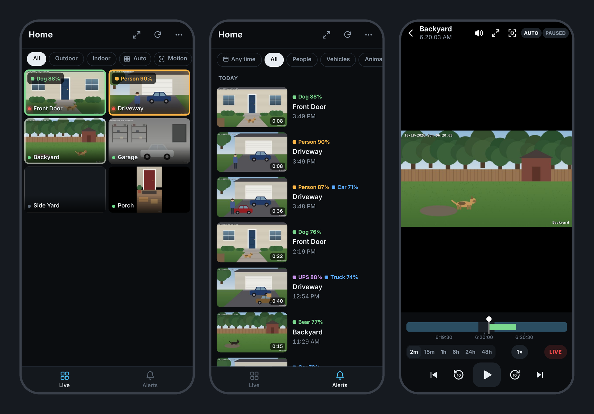
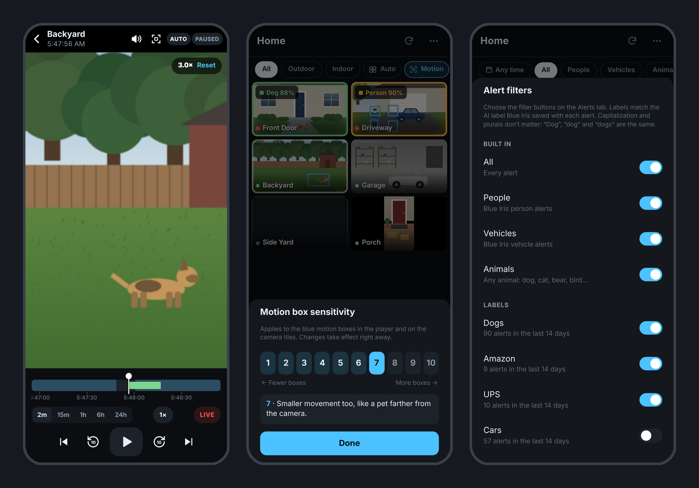
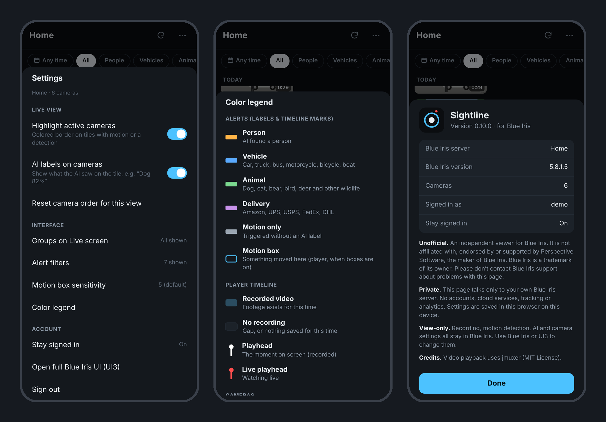
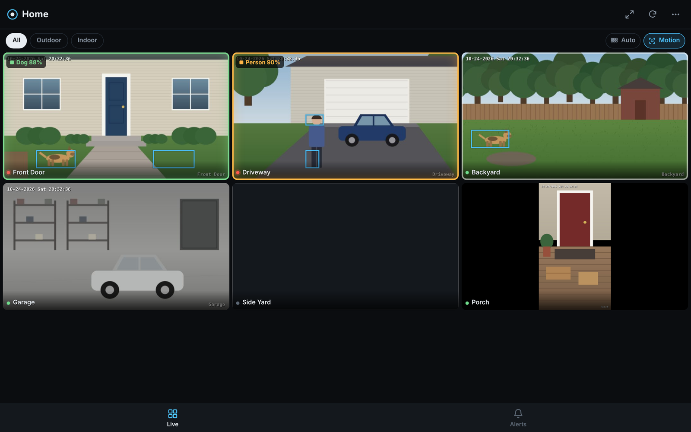
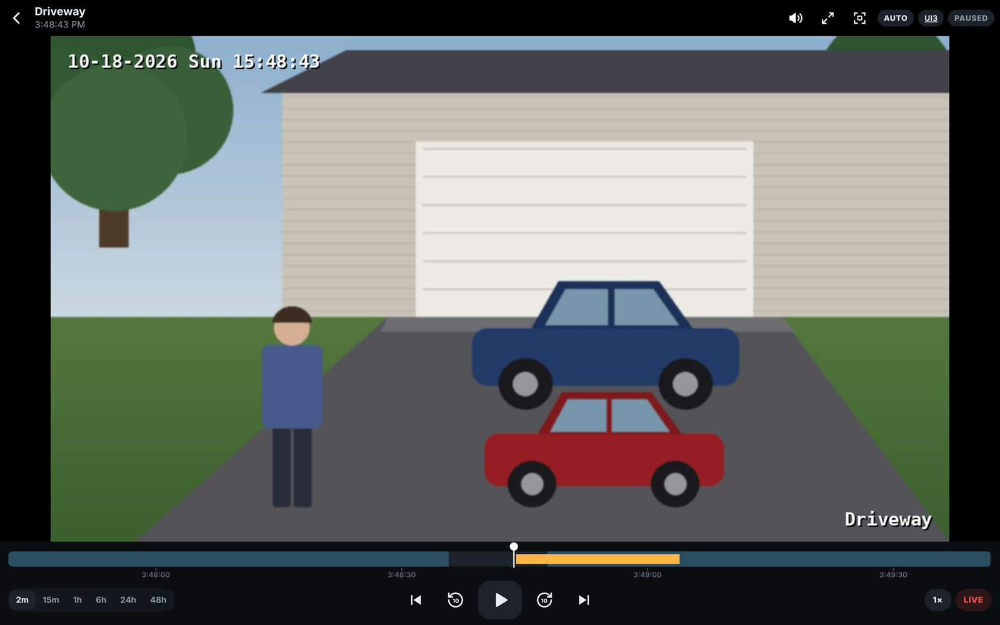

# Sightline for Blue Iris

**A simple, phone-first viewer for [Blue Iris](https://blueirissoftware.com/) live cameras, alerts and playback.**

[](LICENSE)

Sightline is a single web page you drop into Blue Iris's own `www` folder. There is nothing to install and no extra server, container or cloud account: Blue Iris serves the page and handles sign-in, so it works anywhere you can already reach Blue Iris, whether on your home network, over a VPN or through Tailscale.

It's built for the two things you do most: **glancing at your cameras** and **finding out what happened**.



> **Unofficial.** Sightline is an independent project. It is not affiliated with, endorsed by or supported by Perspective Software, the maker of Blue Iris. Blue Iris is a trademark of its owner. Please don't contact Blue Iris support about problems with Sightline.

---

## Contents

- [Features](#features)
- [Screenshots](#screenshots)
- [Requirements](#requirements)
- [Install](#install)
- [Updating and uninstalling](#updating-and-uninstalling)
- [Remote access](#remote-access)
- [Security and privacy](#security-and-privacy)
- [How it works](#how-it-works)
- [Limitations](#limitations)
- [Troubleshooting](#troubleshooting)
- [Development](#development)
- [Credits and license](#credits-and-license)

---

## Features

### Live view
- **A camera grid that fits your screen.** Tiles size themselves so the whole group fits (2 + 2, not 3 + 1), or pick Large / Medium / Small. The choice is remembered for each group.
- **Your Blue Iris groups as buttons** (Outdoor, Indoor and so on). Choose which ones appear.
- **Drag to reorder** cameras, with a separate order for each group.
- **Hidden and disabled cameras stay out of the way.** Cameras marked Hidden in Blue Iris, and disabled cameras, don't appear in the grid or the alerts. A setting lets you show hidden cameras if you want them.
- **Activity at a glance.** A tile's border lights up when Blue Iris sees motion (white) or a trigger, colored by what the AI found (person, vehicle, animal, delivery), with a label such as **"Dog 88%"**.
- **Optional motion boxes on the tiles** show *where* something is moving, so you can follow the dog around the house without opening each camera.

### Alerts
- **AI-aware filter buttons:** People, Vehicles, Animals, plus any label your AI model reports, such as Dogs, UPS or Amazon.
- **Combine filters:** tap several buttons, for example Dogs + People, to see alerts matching any of them. Tap All to clear.
- **Labels picked from real data.** Sightline scans the last 14 days of alerts and lists every label your cameras have actually reported, with counts. You can also type your own. Capitalization and plurals don't matter.
- **Date and time ranges:** last hour, today, yesterday, last night (8 PM–6 AM), or any custom day and time window.
- **Filter by camera or group.**
- **Tap an alert to play it** from the moment it happened.

### Player
- **Smooth video with audio**, both live and recorded. It falls back to still frames on browsers that can't play the stream.
- **A scrubbable timeline** with colored alert markers and zoom levels from 2 minutes to 48 hours. Longer views mark each midnight with the day's name.
- **Quick controls:** previous / next alert, ±10 seconds, playback up to 16× speed, and a one-tap jump to live.
- **Swipe between cameras.**
- **Full screen** for the player or the whole camera grid (handy on a wall display). The player's controls float over the picture and fade out while you watch. Not available on iPhone, where Safari doesn't support it.
- **Digital zoom up to 8×:** pinch or use the mouse wheel, then drag to pan. In Auto quality, Sightline asks Blue Iris for a sharper picture while you're zoomed in.
- **PTZ controls** for cameras Blue Iris marks as PTZ: hold an arrow or + / − to move or zoom, let go to stop; Home; and a list of your saved presets. Live view only.
- **Quality picker** (Auto, 480p to 4K) and a **volume slider**.
- **Motion boxes** with a **1–10 sensitivity** setting.
- Keyboard shortcuts on desktop: space to play / pause, ← → to skip 10 s, ↑ ↓ to switch camera, `+` `−` `0` to zoom, `F` for full screen, Esc to close.

### Everyday comfort
- **Handles dropped connections:** a network blip shows a banner instead of a login screen.
- **Optional "Stay signed in"** keeps you signed in through Blue Iris session timeouts. It's off by default; tick it when signing in or turn it on in Settings.
- **Settings for each device and browser,** so everyone who uses it can set it up their own way.
- **Add to your home screen** and it opens full-screen like an app.
- A built-in **color legend** and an **About** screen showing the Sightline and Blue Iris versions.

## Screenshots

**Zoom, motion box sensitivity and alert filters**



**Settings, color legend and About**



**Desktop**





<sub>Screenshots use a simulated Blue Iris server with drawn placeholder scenes, not real camera footage.</sub>

## Requirements

- **Blue Iris 5** with its **web server** turned on (Blue Iris Settings → *Web server*). Developed and tested on Blue Iris **5.8.1.5**.
- A **Blue Iris user account** to sign in with (Settings → *Users*). A dedicated, non-admin account is recommended; see [Security](#security-and-privacy).
- A **modern browser.** Tested on Chrome for Android and desktop Chrome. Other Chromium browsers (Edge, Brave) should behave the same. Safari (iPhone / iPad) and Firefox should work but haven't been tested yet.
- **For AI labels and filters:** Blue Iris AI detection set up on your cameras (for example CodeProject.AI). Without AI, everything else still works; alerts just won't have labels.
- **For PTZ controls:** a Blue Iris user that's allowed to control PTZ. Without permission, Sightline shows "Access denied" and sends nothing else.
- **For smooth video:** Blue Iris's web streams in **H.264**, which is Blue Iris's usual setting for web viewing. If the browser can't play the stream, Sightline shows still frames instead.

## Install

1. **Download the latest release:** go to [**Releases → Latest**](https://github.com/rw377/Sightline-for-Blue-Iris/releases/latest), download `sightline-x.y.z.zip` and unzip it. It contains these five files:

   | File | What it is |
   |---|---|
   | `sightline.htm` | The app |
   | `sightline-jmuxer.min.js` | Video playback library |
   | `sightline.json` | Home-screen app settings |
   | `sightline-icon-192.png`, `sightline-icon-512.png` | App icons |

   The `www` folder on the `main` branch holds work in progress between releases. Use a release unless you want to test the newest changes.

2. **Copy all five files** into Blue Iris's `www` folder, usually:

   ```
   C:\Program Files\Blue Iris 5\www
   ```

   Windows will ask for administrator permission because the folder is under Program Files. Put the files directly in `www`, not in a subfolder.

3. **Open Sightline** in a browser, using the same address and port you use for Blue Iris's web interface (UI3):

   ```
   http://<blue-iris-address>:<port>/sightline.htm
   ```

   For example `http://192.168.1.50:81/sightline.htm` on your home network.

4. **Sign in** with your Blue Iris username and password.

5. **Optional: add it to your home screen.**
   - Android (Chrome): ⋮ menu → *Add to Home screen*.
   - iPhone / iPad (Safari): Share → *Add to Home Screen*.

   Over plain `http://`, some browsers add a regular shortcut rather than a full-screen app.

No Blue Iris restart is needed. Blue Iris serves any file placed in its `www` folder.

## Updating and uninstalling

- **To update:** download the latest release, copy its files over the old ones, then reload the page. Check **Settings → About** to confirm the version. If the old version still shows, do a hard refresh, or clear the site's cached files in your browser. To hear about new versions, use **Watch → Custom → Releases** on this repository.
- **Your settings survive updates.** They're saved in each browser and don't live in these files.
- **After upgrading Blue Iris,** check that the Sightline files are still in the `www` folder.
- **To uninstall:** delete the five `sightline*` files from the `www` folder.

## Remote access

Sightline goes wherever Blue Iris goes. If you can open Blue Iris's UI3 remotely, you can open `/sightline.htm` the same way.

The safest options are a **VPN** or **[Tailscale](https://tailscale.com/)**. Avoid forwarding Blue Iris's web port straight to the internet. If you must expose it, put it behind a reverse proxy with HTTPS.

## Security and privacy

- **Sightline talks only to your Blue Iris server.** There are no accounts, cloud services, analytics, tracking or third-party requests. The video library is served from your own `www` folder.
- **Sign-in uses Blue Iris's own login.** The password is never sent in plain text; Blue Iris's challenge / response login is used.
- **"Stay signed in" is off by default.** When you turn it on, it stores your Blue Iris username and password in the browser's local storage so the page can sign back in by itself. The password is **obfuscated, not encrypted**: anyone with access to that browser profile could recover it. Only turn it on for devices you trust, never on shared ones. Use a **dedicated, non-admin Blue Iris user** for Sightline either way.
- **Settings are stored per browser** (in local storage, under keys that start with `bis_`). Clearing the site's data resets them.

## How it works

Sightline is a viewer. **Blue Iris does all the heavy lifting:**

- **Blue Iris:** recording and storage; motion detection and triggers; AI detection (through your AI server) and the alert labels; encoding the video streams; still images and thumbnails; sign-in and sessions.
- **Your browser:**
  - Plays the stream. Blue Iris's stream format is repackaged on the fly for the browser's video player, without re-encoding.
  - Draws the motion boxes, by comparing frames.
  - Handles digital zoom.
  - Filters alerts by label.
  - Handles layout and settings.

While the Live screen is open, Sightline checks Blue Iris for motion / trigger status every 2 seconds and for new alerts every 4 seconds. Each check is very small. With motion boxes on, tiles refresh more often (every 0.6 s instead of 1.5 s), which asks Blue Iris for more snapshots.

## Limitations

- **View-only.** Recording, motion zones, AI settings and camera configuration stay in Blue Iris / UI3.
- **Not yet supported:** push notifications, clip download / export, two-way audio. PTZ covers moving, zooming, Home and going to presets; saving presets and focus / IR controls stay in Blue Iris / UI3.
- **Motion boxes are drawn by the browser.** They are an approximation and don't use Blue Iris's motion zones.
- **Smooth video needs an H.264 web stream.** Otherwise you get still frames.

## Troubleshooting

| Problem | What to check |
|---|---|
| **Sent back to the login screen on every refresh** | Open the page through Blue Iris (`http://…:port/sightline.htm`), not as a local file. If you edited `sightline.htm`, see [Development](#development): the file must stay ASCII-only and must never contain two percent signs in a row. |
| **"Invalid login"** | Check the username and password, and that the Blue Iris user is allowed to use the web server. |
| **"Smooth video unavailable — showing still frames"** | Your browser can't play the stream. Check that Blue Iris's web streaming uses H.264, or try another browser. |
| **No AI labels, or alert filters show no labels** | Blue Iris AI isn't set up on those cameras, or no alerts have labels yet. Labels must match what your AI model reports (for example `dog`, `person`, `car`). |
| **Changes don't appear after updating** | Check Settings → About for the version, then hard-refresh or clear the site's cached files. |
| **Odd characters such as `×` in the page** | The file was saved with non-ASCII characters. Re-download it from this repository. |
| **A camera tile stays dark with a grey dot** | Blue Iris reports that camera as offline or with no signal. |

## Development

Sightline is deliberately simple: **one HTML file with inline CSS and JavaScript, no build step and no dependencies** apart from the bundled jmuxer library. Edit `www/sightline.htm`, copy it to Blue Iris's `www` folder and reload.

**Two rules that Blue Iris imposes on `.htm` files:**

1. **Keep the file ASCII-only.** Blue Iris serves `.htm` files as Latin-1, so any non-ASCII character is garbled. Use `\uXXXX` escapes in JavaScript and `&#NNNN;` entities in HTML.
2. **Never put two percent signs next to each other** anywhere in the file, including comments and strings. Blue Iris treats `%%NAME%%` as a template placeholder: it fills in the ones it knows and blanks out everything between unknown pairs. Sightline uses exactly two, `%%SESSION%%` and `%%SYSNAME%%`, near the top of the script. The file should contain exactly four `%%` sequences.

**Versioning:** add every change to the **Unreleased** section at the top of [CHANGELOG.md](CHANGELOG.md). Between releases, `APP.version` ends in `-dev` (for example `0.13.0-dev`), so a test copy shows as such in Settings → About. To release:

1. Rename "Unreleased" to the new version and date.
2. Set `APP.version` to that version (no `-dev`).
3. Publish a GitHub Release tagged `vX.Y.Z` with a zip of the five `www` files.
4. Set `APP.version` to the next `-dev` version.

Small fixes bump the last number (0.12.1), new features the middle one (0.13.0).

**Blue Iris API used:** the JSON API (`login`, `camlist`, `alertlist`, `timeline`, `status`, `logout`), plus `/image/`, `/thumbs/`, `/file/clips/`, `/time/` and `/video/` for pictures and streams.

## Credits and license

- Video playback uses [jmuxer](https://github.com/samirkumardas/jmuxer) by Samir Das (MIT License). Its license header is kept in `sightline-jmuxer.min.js`.
- Sightline is free software, licensed under the **[GNU General Public License v3.0 or later](LICENSE)**. You're free to use it, study it, change it and share it, including at a business. If you distribute Sightline or a modified version, it must stay under the GPL with its source code included, and the copyright and license notices must be kept. It comes with no warranty.
